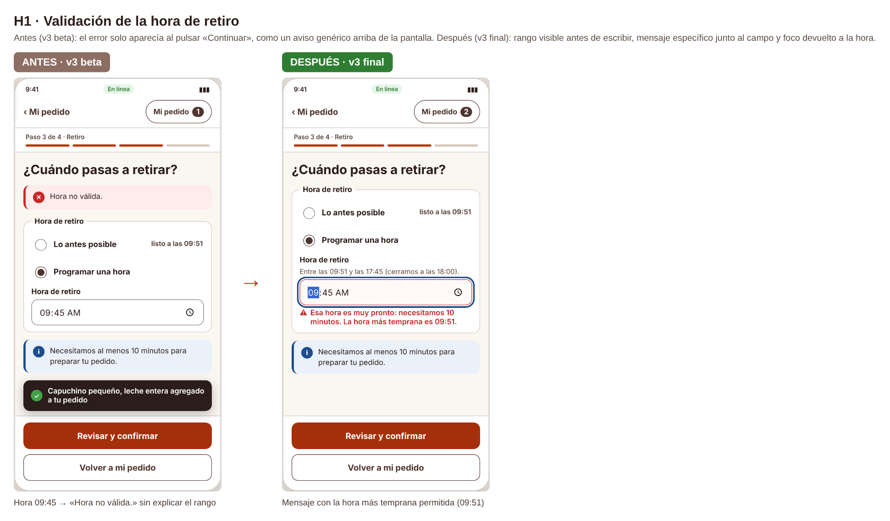
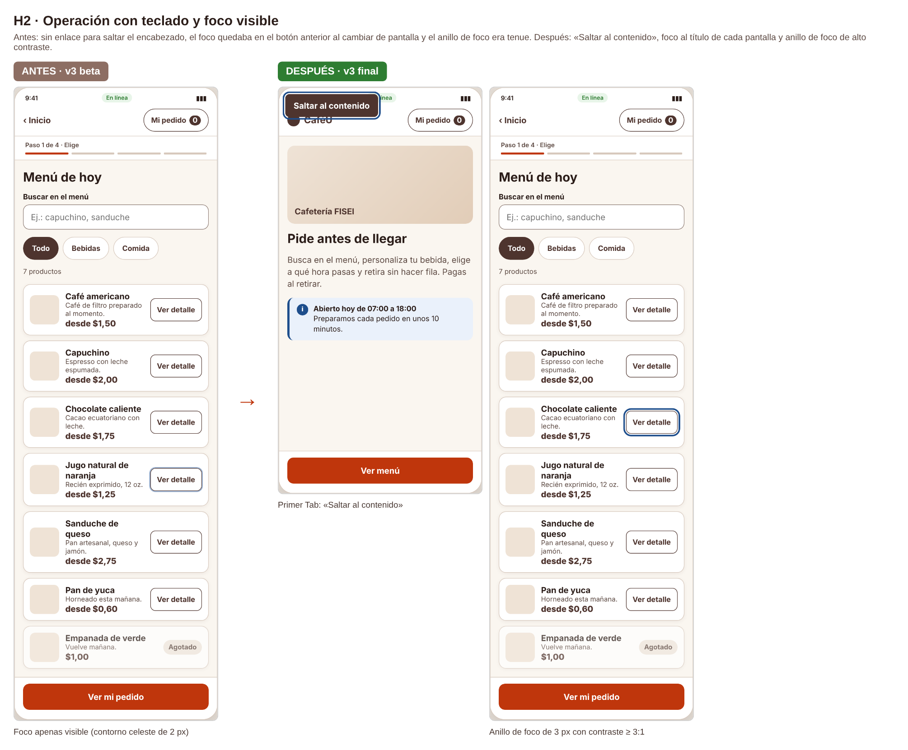
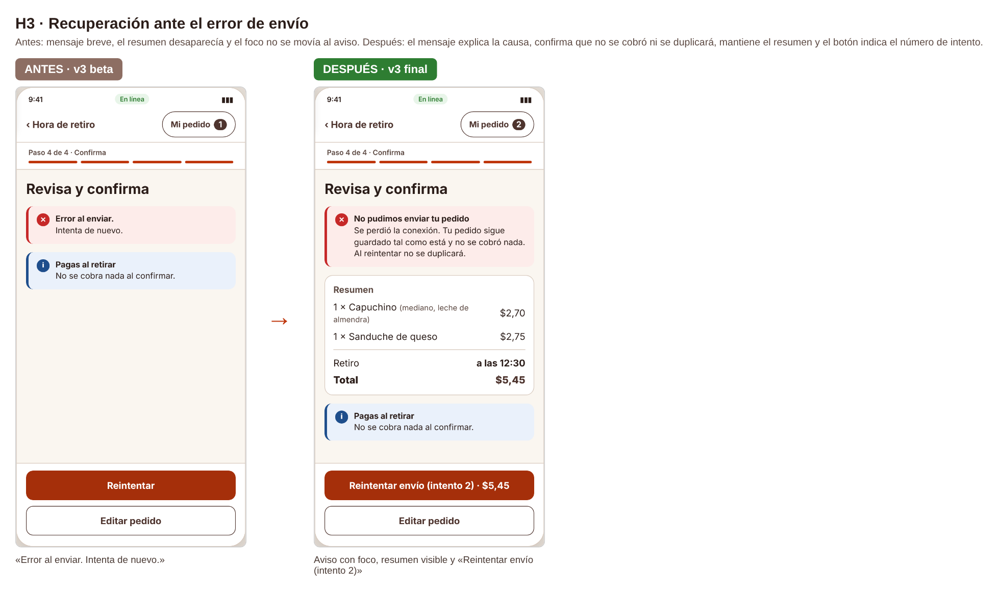
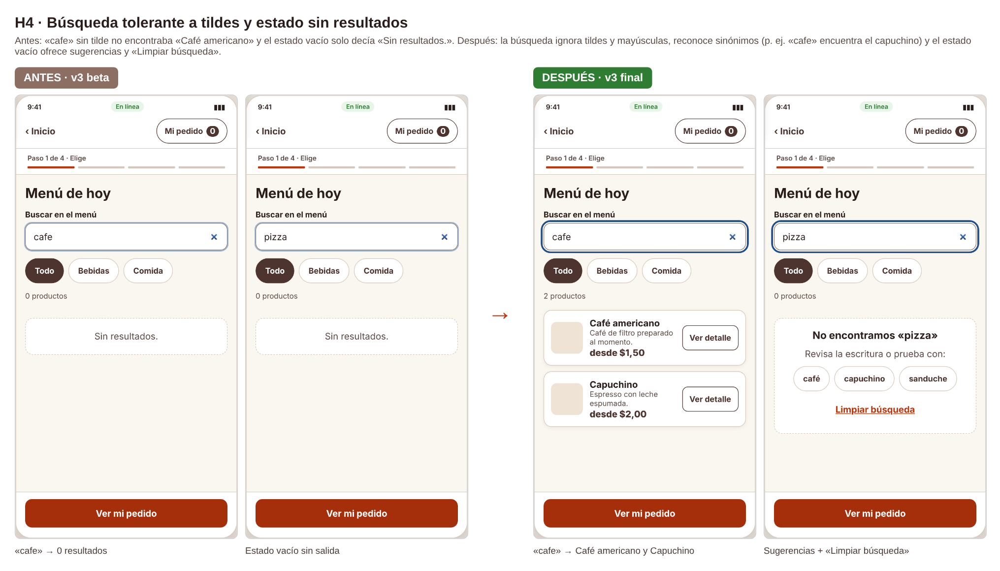
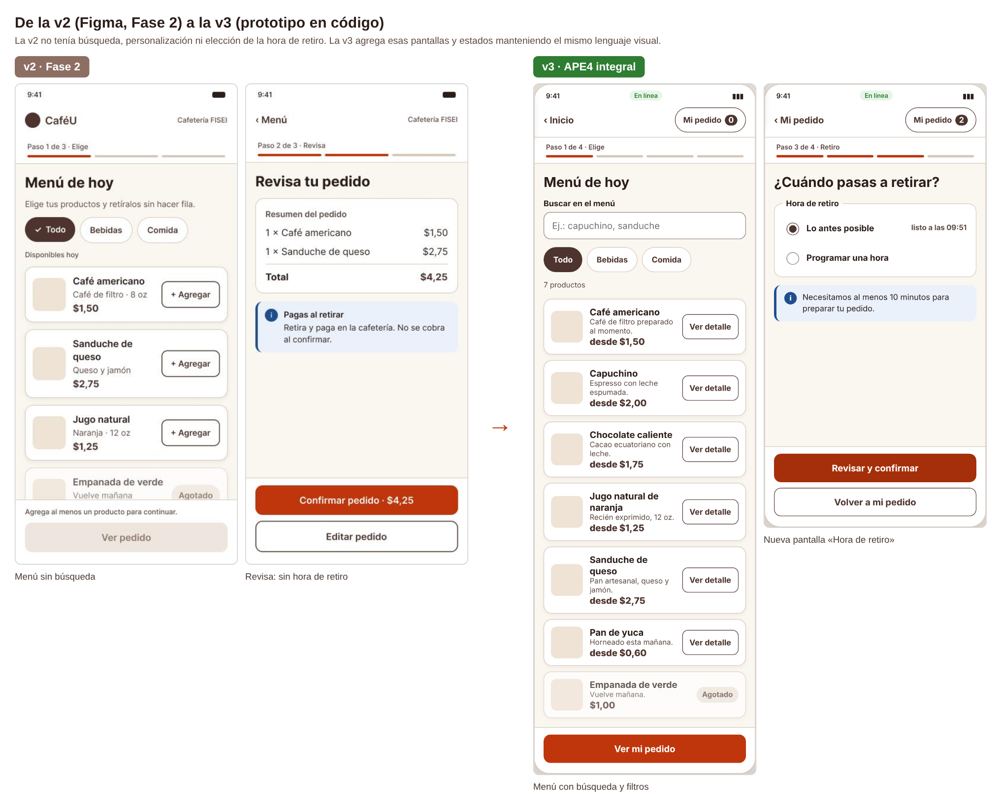

# Iteración · Antes y después (v3 beta → v3 final)

**Responsable:** Vinces Cueva Boris Yussef · **Prototipos:** `../prototipo/cafeu-v3-beta.html` (antes) y `../prototipo/cafeu-v3.html` (después)

Se corrigieron los **cinco** hallazgos de `../pruebas/hallazgos.md` (el mínimo pedido es tres). Cada corrección se verificó con las mismas personas y tareas el 24/10/2026.

## H1 · Validación de la hora de retiro (severidad 4)

| | Antes (beta) | Después (final) |
|---|---|---|
| Cuándo valida | Solo al pulsar «Revisar y confirmar». | Al salir del campo y al continuar. |
| Mensaje | «Hora no válida.» arriba de la pantalla. | «Esa hora es muy pronto: necesitamos 10 minutos. La hora más temprana es 09:51.» junto al campo. |
| Prevención | Sin rango visible. | Pista permanente: «Entre las 09:51 y las 17:45 (cerramos a las 18:00).» |
| Accesibilidad | Sin asociación con el campo. | `aria-invalid="true"`, `aria-describedby` y foco devuelto al campo. |

**Justificación:** P01 no pudo programar la hora (3 intentos) y P02 no vio el aviso. Aplica N5 Prevención y N9 Recuperación de errores, y WCAG 3.3.1 / 3.3.3. **Resultado:** T2 pasó de 107 s a 49 s de media y de 5 a 1 error.

## H2 · Teclado y foco visible (severidad 3)

| | Antes | Después |
|---|---|---|
| Saltar encabezado | No existe. | «Saltar al contenido» es el primer elemento con Tab. |
| Foco al cambiar de pantalla | Se queda al inicio o en el botón anterior. | Pasa al título (`h1`) de la nueva pantalla. |
| Indicador de foco | 2 px #9DB4D3, contraste 1,97:1. | 3 px #1E4E8C con separación de 2 px, contraste 7,73:1. |

**Justificación:** P02 perdió el foco dos veces y recorría el encabezado en cada pantalla. WCAG 2.4.1, 2.4.3, 2.4.7 y 2.4.13. **Resultado:** T1 de P02 bajó de 84 s a 39 s sin pérdidas de foco.

## H3 · Recuperación ante el error de envío (severidad 3)

| | Antes | Después |
|---|---|---|
| Mensaje | «Error al enviar. Intenta de nuevo.» | «No pudimos enviar tu pedido. Se perdió la conexión. Tu pedido sigue guardado tal como está y no se cobró nada. Al reintentar no se duplicará.» |
| Resumen | Se ocultaba. | Sigue visible con el total. |
| Foco y anuncio | Se quedaba en el botón. | Pasa al aviso (`role="alert"`, `tabindex="-1"`). |
| Botón | «Reintentar». | «Reintentar envío (intento 2) · $2,70». |

**Justificación:** P01 dudó por miedo a un cobro doble; P02 no percibió el error. N1, N9 y WCAG 4.1.3. **Resultado:** T3 sin dudas ni errores en ambas personas (45 s → 32 s).

## H4 · Búsqueda tolerante (severidad 3)

| | Antes | Después |
|---|---|---|
| Coincidencia | Exacta en nombre y descripción, sensible a tildes. | Ignora tildes y mayúsculas; busca también por sinónimos (café, cappuccino, sandwich). |
| «cafe» | 0 productos. | 2 productos (Café americano y Capuchino). |
| Sin resultados | «Sin resultados.» | «No encontramos «pizza»», sugerencias (café, capuchino, sanduche) y «Limpiar búsqueda». |

**Justificación:** P01 concluyó que no había café y P02 necesitó dos búsquedas. N6 y N9. **Resultado:** T1 de 71 s a 31,5 s de media.

## H5 · Duración del aviso «Deshacer» (severidad 2)
Ver `../evidencias/capturas-v3/v3-08-quitado-deshacer.png`. El aviso pasó de 2 s a 6 s y, tras «Quitar», el foco va directo a «Deshacer». **Justificación:** N3 Control y libertad; WCAG 2.2.1. **Resultado:** P02 alcanzó a leer y usar el aviso.

## De la v2 a la v3

La v3 cubre lo que la v2 no tenía (diagnóstico P1–P5): hora de retiro, personalización, búsqueda, operación con teclado y estados que responden a lo que la persona escribe.
