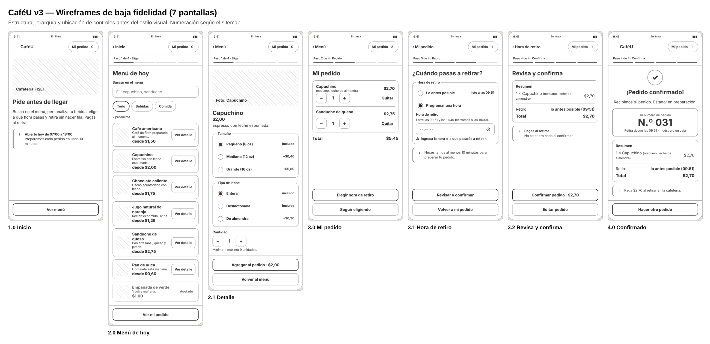

# Wireframes de baja fidelidad · CaféU v3

**Responsable:** González Álvarez Vladimir Humberto

| Archivo | Pantalla (numeración del sitemap) | Propósito |
|---|---|---|
| `wf-01-inicio.png` | 1.0 Inicio | Horario, tiempo de preparación y acción única «Ver menú». |
| `wf-02-menu.png` | 2.0 Menú de hoy | Buscar, filtrar y elegir un producto; muestra el estado «Agotado». |
| `wf-03-detalle.png` | 2.1 Detalle | Tamaño, tipo de leche y cantidad con el precio en el botón. |
| `wf-04-mi-pedido.png` | 3.0 Mi pedido | Cambiar cantidades, quitar y ver el total. |
| `wf-05-hora-retiro.png` | 3.1 Hora de retiro (nueva) | «Lo antes posible» o programar una hora con rango visible. |
| `wf-06-revisar-confirmar.png` | 3.2 Revisa y confirma | Resumen, hora, total y nota de pago al retirar. |
| `wf-07-confirmacion.png` | 4.0 Pedido confirmado | Número de pedido grande, hora de retiro y resumen. |

Los wireframes se generan desde el mismo código del prototipo con `../prototipo/cafeu-v3.html?vista=wireframe`, así estructura y prototipo no se desalinean.

## Decisiones de diseño
**Jerarquía visual.** Cada pantalla tiene un solo título (`h1`) y una sola acción principal en la zona inferior, al alcance del pulgar; la acción secundaria va debajo, con contorno. El precio y el total usan el mayor peso tipográfico después del título.

**Gestalt.**
- *Proximidad:* nombre, descripción y precio del producto forman un bloque; «Ver detalle» queda a la derecha del mismo bloque.
- *Región común:* tamaño y tipo de leche están en tarjetas separadas (`fieldset`), cada una con su leyenda.
- *Semejanza:* todos los botones principales comparten forma y color; los chips de filtro y las sugerencias tienen la misma forma redondeada.
- *Continuidad:* la barra «Paso n de 4» conecta las pantallas 2.0 → 3.2 como un solo recorrido.

**Carga cognitiva.**
- Divulgación progresiva: las opciones de personalización aparecen solo en el detalle, y el campo de hora solo al elegir «Programar una hora».
- Valores por defecto seguros (pequeño, leche entera, «Lo antes posible»), así la persona solo cambia lo que necesita.
- Reconocer antes que recordar: el rango de horas, el precio con extras (+$0,40, +$0,30) y el total están siempre a la vista.
- Máximo 7 productos visibles y 3 opciones por grupo.
