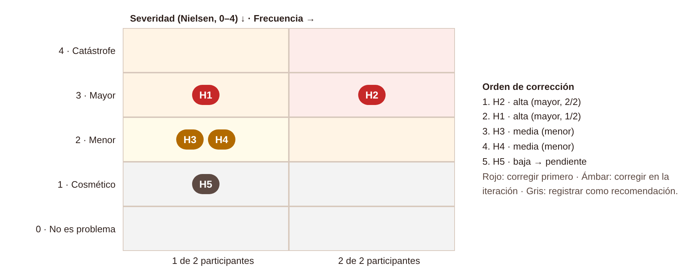

# Hallazgos, priorización y recomendaciones — CaféU (APE 4, Fase 2)

| ID | Hallazgo y evidencia | Heurística | Severidad (0–4) | Frecuencia | Prioridad | Decisión |
|---|---|---|---|---|---|---|
| H2 | Al editar no se distingue un cambio guardado de uno pendiente; «Quitar» parece irreversible (U1-T2, U2-T2) | Visibilidad del estado; control y libertad | 3 · Mayor | 2/2 | 1 · Alta | Corregido en v2 |
| H1 | No hay confirmación al agregar un producto (U1-T1) | Visibilidad del estado del sistema | 3 · Mayor | 1/2 | 2 · Alta | Corregido en v2 |
| H3 | El número de pedido es poco visible (U2-T1) | Reconocer antes que recordar; RNF-02 | 2 · Menor | 1/2 | 3 · Media | Corregido en v2 |
| H4 | Miedo a duplicar o pagar dos veces al reintentar (U2, caso de error) | Recuperarse de errores | 2 · Menor | 1/2 | 4 · Media | Corregido en v2 |
| H5 | Al tocar «Agotado» no hay respuesta (U1-T1) | Visibilidad del estado | 1 · Cosmético | 1/2 | 5 · Baja | Pendiente |

## Matriz de mejoras (v1 → v2)
| Hallazgo | v1 | v2 | Justificación |
|---|---|---|---|
| H1 | Solo cambiaba el botón de la tarjeta | Aviso flotante, tarjeta «✓ Agregado» y botón «Ver pedido · 1 producto · $1,50» animado | Feedback inmediato y redundante evita repetir la acción |
| H2 | El producto desaparecía sin aviso | Subtítulo «Nada se guarda hasta pulsar…», aviso «Cambios sin guardar» (total anterior → nuevo) y «Deshacer» | Estado pendiente visible y salida reversible |
| H3 | «Pedido N.º 024» a 14 px dentro del resumen | Tarjeta con «N.º 024» a 40 px y «Muéstralo en caja» | Legible a distancia en caja (RNF-02) |
| H4 | «Tu pedido sigue guardado.» | «No se cobró nada. Al reintentar no se duplicará.» | Reduce la incertidumbre ante el error |

Evidencia visual: `06_antes_despues/v1_vs_v2_h1_h2.png` y `v1_vs_v2_h3_h4.png`.

## Recomendaciones
1. Repetir la prueba con la v2 y al menos cinco participantes, midiendo tiempo, errores y SEQ.
2. Resolver H5 y revisar con lector de pantalla y texto al 200 %.
3. Mantener la biblioteca de componentes y estados como sistema de diseño y documentar los tiempos de las microinteracciones (150–300 ms).
