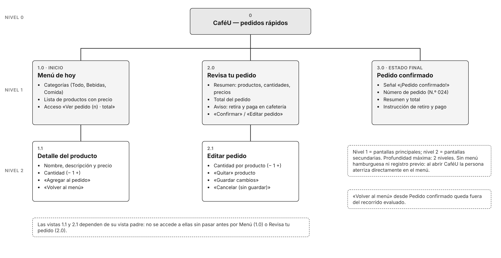
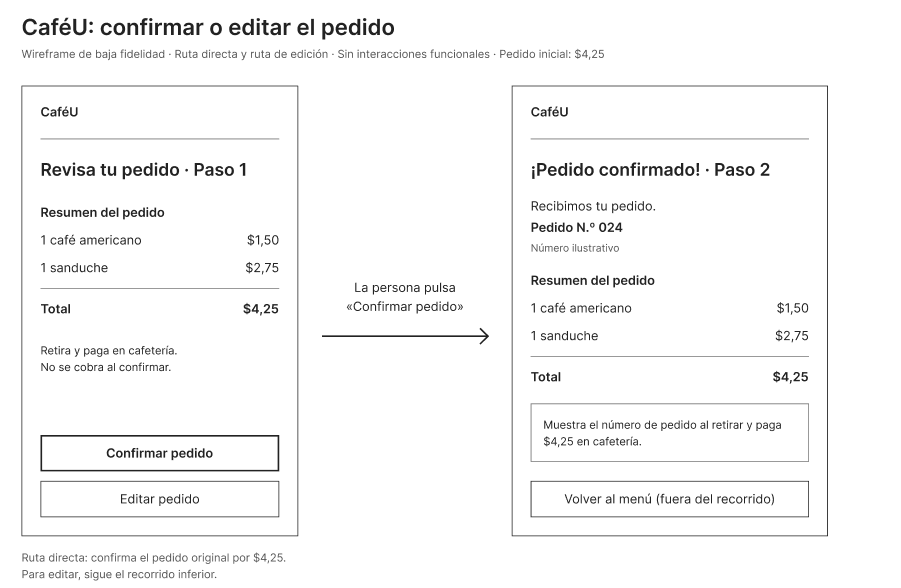
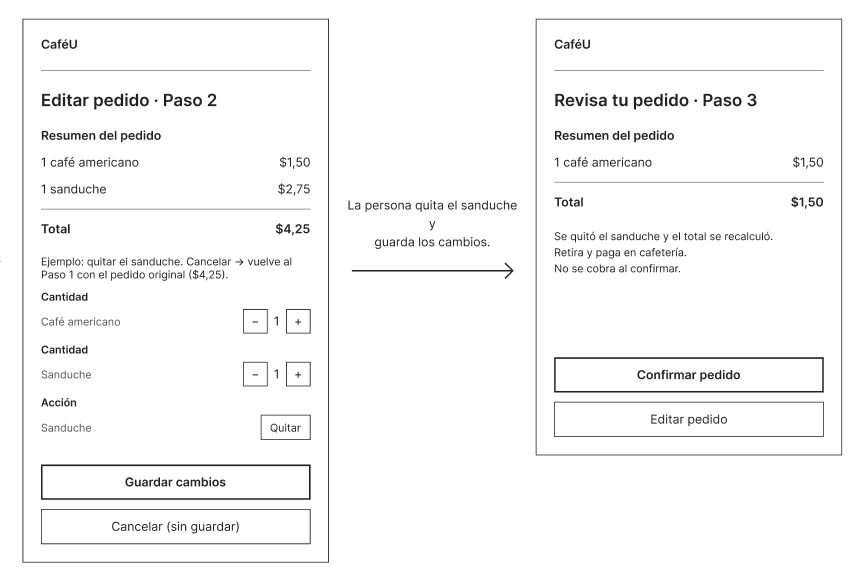

# APE04_IHC — Interacción Humano Computador

**APE 4 – Fase 1: De los requisitos a la arquitectura de información, navegación y wireframes de baja fidelidad**

Universidad Técnica de Ambato · FISEI · Carrera de Software
Asignatura: Interacción Humano Computador · 5.º semestre, paralelo A
Docente: Ing. José Caiza, Mg.

---

## Caso de estudio: CaféU

CaféU es una cafetería universitaria ficticia. Un estudiante tiene poco tiempo durante su descanso y quiere pedir **sin explicar verbalmente su pedido** mientras espera en una fila concurrida. El sistema debe permitirle consultar el menú, elegir productos, revisar su pedido, confirmarlo y recibir una señal clara de que fue recibido.

**Tarea principal:** abrir el menú → elegir un producto → revisar el pedido → confirmar → ver la confirmación.

**Situación del taller:** el estudiante revisa su pedido —1 café americano ($1,50) + 1 sanduche ($2,75) = **$4,25**—. ¿Qué ocurre si confirma? ¿Y si decide editarlo?

## Proceso aplicado

```
Requisito → Pantalla → Sitemap → User flow → Componentes → Wireframe
```

| Paso | Qué responde | Resultado en CaféU |
|---|---|---|
| Requisito | ¿Qué necesita cada usuario? | 6 requisitos funcionales y 3 no funcionales |
| Pantalla | ¿Dónde se resuelve cada requisito? | Matriz de requisitos, usuarios y pantallas |
| Sitemap | ¿Dónde vive cada contenido? | 5 pantallas en 2 niveles |
| User flow | ¿Qué pasos, decisiones y errores hay? | Realizar un pedido y editar el pedido |
| Componentes | ¿Con qué controles actúa la persona? | Esquema de navegación e inventario de 14 componentes |
| Wireframe | ¿Cómo se distribuye cada pantalla? | 7 pantallas y 2 estados de error en baja fidelidad |

## Entregables

Todos los archivos están en la carpeta [`APE4_FASE1/`](APE4_FASE1/).

| # | Entregable de la guía | Archivo |
|---|---|---|
| 1 | Matriz de requisitos y pantallas | [01_matriz_requisitos_pantallas.md](APE4_FASE1/01_matriz_requisitos_pantallas.md) |
| 2 | Sitemap del proyecto | [02_sitemap.png](APE4_FASE1/02_sitemap.png) |
| 3 | Dos diagramas user flow | [03_user_flow_1_realizar_pedido.png](APE4_FASE1/03_user_flow_1_realizar_pedido.png) · [04_user_flow_2_editar_pedido.png](APE4_FASE1/04_user_flow_2_editar_pedido.png) |
| 4 | Esquema de navegación e inventario de componentes | [05_navegacion.png](APE4_FASE1/05_navegacion.png) · [05_inventario_componentes.md](APE4_FASE1/05_inventario_componentes.md) |
| 5 | Wireframes de baja fidelidad | [06_wireframes/](APE4_FASE1/06_wireframes/) |
| 6 | Documento PDF con la explicación didáctica | [07_APE4_Fase1_Informe.pdf](APE4_FASE1/07_APE4_Fase1_Informe.pdf) · [versión Word](APE4_FASE1/07_APE4_Fase1_Informe.docx) |
| 7 | Prototipo en Figma | [Abrir archivo de Figma](https://www.figma.com/design/TO6AmVVBbCJxYHiHZDvW9U/Untitled?node-id=0-1&t=HgtnEBDAIhnkxZzp-1) |

## Vista previa

**Sitemap**



**Wireframes: ruta directa (confirmar el pedido)**



**Wireframes: ruta de edición (quitar el sanduche y guardar)**



## Integrantes y aportes

| Integrante | Aporte en el repositorio |
|---|---|
| González Álvarez Vladimir Humberto | README, informe (Word y PDF) |
| Acaro Ibujés Pedro Sebastián | Matriz de requisitos y sitemap (Actividades 1 y 2) |
| Mora Beltrán Santiago Sebastián | User flows 1 y 2 (Actividad 3) |
| Vinces Cueva Boris Yussef | Navegación, inventario de componentes y wireframes (Actividades 4 y 5) |
